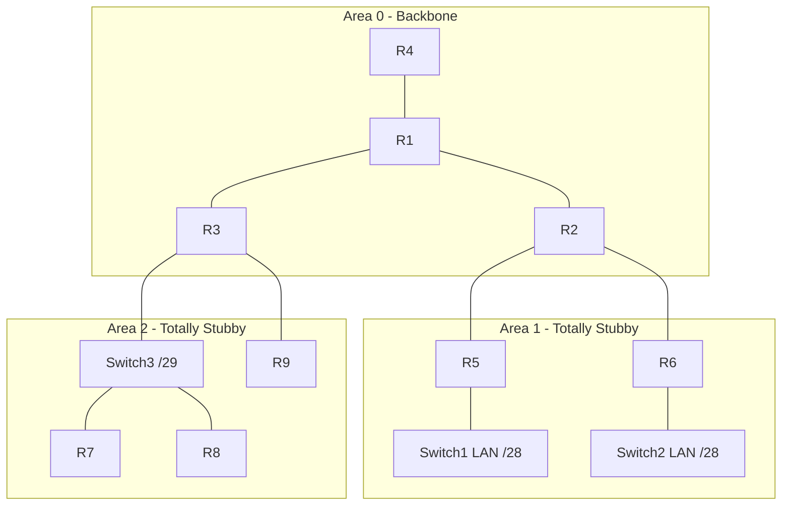

# Multi-Area OSPFv2 Design Lab: Hierarchical IP Plan, Totally Stubby Areas & ABR Summarization


This repository contains the full architecture, Cisco IOS-XE configurations, protocol behavioral analysis, and Wireshark control-plane validation tasks for a **three-area OSPFv2 design** (Area 0 backbone, Areas 1 and 2 totally stubby) built entirely inside a single **192.168.1.0/24** address block.

> Replace `OWNER/REPO` in the badge above with your GitHub path after publishing.

---

## 📋 Overview & Design Objectives

* **Hierarchical Addressing (`192.168.1.0/24`):**
  * **Aligned Area Blocks:** Each area owns one contiguous block, so each ABR advertises exactly one summary route.
  * **VLSM Efficiency:** `/31` point-to-point links (RFC 3021), a `/29` multi-access segment, `/28` access LANs and `/32` loopbacks.
  * **Predictable Router-IDs:** Loopback0 doubles as the OSPF router-ID on every router.
* **Multi-Area OSPF Behavior:**
  * **ABR Roles:** R2 (Area 0/1) and R3 (Area 0/2) are the only exits of their areas; Area 0 is contiguous, so no virtual links are needed.
  * **Totally Stubby Areas:** `area X stub` on all members, `no-summary` on the ABR only. Leaf routers carry one default route plus their own area's prefixes.
  * **Inter-Area Summarization:** `area range` on both ABRs collapses each area into a single Type 3 LSA and installs a Null0 discard route.
* **Network-Type Contrast:**
  * **Point-to-Point (`/31` links):** No DR/BDR election, no Type 2 LSA, instant `FULL` adjacency.
  * **Broadcast (`192.168.1.152/29`, Area 2):** Deterministic election, R3 = DR (priority 100), R7 = BDR (50), R8 = DROTHER (0).

---

## 📐 Network Topology




---

## 🧭 Address Space Allocation

| Block | Use |
| :--- | :--- |
| `192.168.1.0/27` | **Area 0**: `.0/28` loopbacks, `.16/28` links |
| `192.168.1.32/27` | Area 0 reserve (growth, R4's future role) |
| `192.168.1.64/26` | **Area 1**, summarized by R2 |
| `192.168.1.128/26` | **Area 2**, summarized by R3 |
| `192.168.1.192/26` | Spare for a future area |

## 🏷️ Addressing Matrix & OSPF Interface Roles

| Node | Area | Interface | IP Address / Mask | OSPF Network Type | Role |
| :--- | :--- | :--- | :--- | :--- | :--- |
| **R1** | 0 | `Lo0`<br>`Gi0/0`<br>`Gi0/1`<br>`Gi0/2` | `192.168.1.1/32`<br>`192.168.1.16/31`<br>`192.168.1.18/31`<br>`192.168.1.20/31` | Loopback<br>P2P to R2<br>P2P to R3<br>P2P to R4 | RID / Backbone internal |
| **R2** | 0 / 1 | `Lo0`<br>`Gi0/0`<br>`Gi0/1`<br>`Gi0/2` | `192.168.1.2/32`<br>`192.168.1.17/31`<br>`192.168.1.80/31`<br>`192.168.1.82/31` | Loopback<br>P2P to R1 (A0)<br>P2P to R5 (A1)<br>P2P to R6 (A1) | **ABR** (Area 1) |
| **R3** | 0 / 2 | `Lo0`<br>`Gi0/0`<br>`Gi0/1`<br>`Gi0/2` | `192.168.1.3/32`<br>`192.168.1.19/31`<br>`192.168.1.153/29`<br>`192.168.1.144/31` | Loopback<br>P2P to R1 (A0)<br>Broadcast (A2), priority 100<br>P2P to R9 (A2) | **ABR** (Area 2) / **DR** |
| **R4** | 0 | `Lo0`<br>`Gi0/0` | `192.168.1.4/32`<br>`192.168.1.21/31` | Loopback<br>P2P to R1 | Backbone leaf |
| **R5** | 1 | `Lo0`<br>`Gi0/0`<br>`Gi0/1` | `192.168.1.69/32`<br>`192.168.1.81/31`<br>`192.168.1.97/28` | Loopback<br>P2P to R2<br>Broadcast (Passive) | Internal / LAN gateway |
| **R6** | 1 | `Lo0`<br>`Gi0/0`<br>`Gi0/1` | `192.168.1.70/32`<br>`192.168.1.83/31`<br>`192.168.1.113/28` | Loopback<br>P2P to R2<br>Broadcast (Passive) | Internal / LAN gateway |
| **R7** | 2 | `Lo0`<br>`Gi0/0` | `192.168.1.135/32`<br>`192.168.1.154/29` | Loopback<br>Broadcast, priority 50 | Internal / **BDR** |
| **R8** | 2 | `Lo0`<br>`Gi0/0` | `192.168.1.136/32`<br>`192.168.1.155/29` | Loopback<br>Broadcast, priority **0** | Internal / **DROTHER** |
| **R9** | 2 | `Lo0`<br>`Gi0/0` | `192.168.1.137/32`<br>`192.168.1.145/31` | Loopback<br>P2P to R3 | Internal |

---

## 🧪 Deep-Dive Protocol Behavioral Comparison

| Feature / Behavior | Broadcast (Switch3 `/29`) | Point-to-Point (`/31` links) |
| :--- | :--- | :--- |
| **DR/BDR Election** | Enabled (deterministic via priority) | Disabled (instant formation) |
| **Multicast Addresses Used** | `224.0.0.5` (All) & `224.0.0.6` (DR) | `224.0.0.5` only |
| **Type 2 Network LSA Generated?** | Yes (by R3, the DR) | No |
| **Neighbor Adjacency States** | `FULL` with DR/BDR, `2WAY` between DROTHERs | Always `FULL` |
| **Mask Requirement for Adjacency** | Must match exactly | Subnet mask can differ (IOS) |

### Key Design Points

1. **Single exit per area.** Areas 1 and 2 are single-homed, so totally stubby areas and summarization cannot cause sub-optimal routing or blackholes.
2. **No ECMP in this topology.** It is a tree apart from the Switch3 segment, so R1 is the single point of failure for inter-area traffic. An optional R2-R3 link (`192.168.1.22/31`) is reserved in the plan.
3. **Deterministic DR.** The election is non-preemptive. Bring R3 up first, or run `clear ip ospf process` after setting the priorities.
4. **Expected LSDB.** Types 1 and 3, plus one Type 2 for the Area 2 segment.

---

## ✅ Verification Quick Reference

| Check | Expected result |
| :--- | :--- |
| Neighbor counts | R1 3, R2 3, R3 4, R4 1, R5 1, R6 1, R7 2, R8 2, R9 1 |
| R1 routes | `.2/32`, `.3/32`, `.4/32`, `O IA` `.64/26` and `.128/26` |
| R5 routes | `O*IA 0.0.0.0/0` via `192.168.1.80`, plus `.70/32`, `.82/31`, `.112/28` |
| R2 summary | `192.168.1.64/26` pointing to Null0 |
| End-to-end | `ping 192.168.1.137 source Gi0/1` from R5; path R2 -> R1 -> R3 -> R9 |

Full details, failure modes and Wireshark tasks: [`docs/04-verification-and-troubleshooting.md`](docs/04-verification-and-troubleshooting.md).

---

## 🗂️ Repository Layout

```text
.
├── README.md
├── LICENSE
├── configs/                     # Per-device IOS-XE configs (R1-R9, Switch1-3)
├── docs/
│   ├── topology.png
│   ├── 01-topology-analysis.md
│   ├── 02-ip-addressing-plan.md
│   ├── 03-ospf-design-decisions.md
│   └── 04-verification-and-troubleshooting.md
├── captures/                    # Put your Wireshark .pcapng files here
├── scripts/validate_configs.py  # Offline consistency checker
└── .github/workflows/validate.yml
```

## 🚀 Getting Started

1. Build the topology in EVE-NG (or GNS3) exactly as drawn, using the interface names shown in [`docs/topology.png`](docs/topology.png).
2. Paste each file from [`configs/`](configs/) into the matching device. If your IOS image rejects a command, check the optional-hardening notes in `docs/03`.
3. Wait for adjacencies, then run the checks in [`docs/04-verification-and-troubleshooting.md`](docs/04-verification-and-troubleshooting.md).
4. Optionally check the configs offline before loading them:

```bash
python3 scripts/validate_configs.py
```

The validator confirms router-IDs, unique addressing, /31 and /29 link consistency, area-range coverage and stub flags. It does not emulate OSPF, so it complements the live checks rather than replacing them.

## 🔭 Possible Extensions

* Add the R2-R3 link in Area 0 and observe the cost-based path change.
* Inject external routes from R4 (ASBR) and compare Type 4/5 LSAs with Areas 1/2 as normal stub or NSSA.
* OSPF authentication (HMAC-SHA-256 key chains) and BFD on transit links.
* Convert the lab to OSPFv3 / dual-stack.

## 📄 License

Released under the [MIT License](LICENSE).
